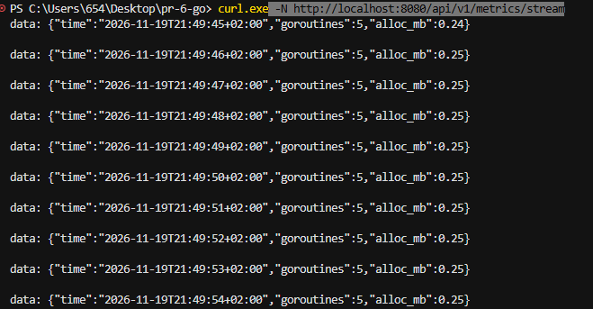
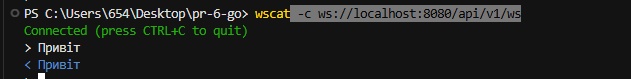

# Практична робота № 6
## Реалізація взаємодії в реальному часі (Real-Time) за допомогою Server-Sent Events (SSE) та WebSockets у Go


---

## Мета роботи

- Опанувати технологію **Server-Sent Events (SSE)** для організації однонапрямленого потокового передавання системних метрик від сервера до клієнта поверх протоколу HTTP.
- Навчитися контролювати життєвий цикл HTTP-з'єднання за допомогою `http.Flusher` та контексту запиту `r.Context().Done()`, запобігаючи витокам горутин і пам'яті.
- Опанувати протокол **WebSocket** (`github.com/gorilla/websocket`) для двонапрямленої (повнодуплексної) комунікації в реальному часі.
- Реалізувати конкурентний архітектурний патерн **Hub (Broadcast)** із використанням горутин, каналів (`chan`) та оператора `select`.

## Технологічний стек та залежності

| Технологія | Призначення |
|---|---|
| Go (Golang) | Мова програмування |
| net/http | Створення HTTP-сервера та обробка запитів |
| runtime | Отримання системних метрик Go |
| time | Робота з часом та таймерами |
| encoding/json | Серіалізація даних у формат JSON |
| Gorilla WebSocket | Реалізація WebSocket-з'єднань |
| curl.exe | Тестування SSE-потоку |
| wscat | Тестування WebSocket-з'єднань |

**Основна бібліотека:**

- `github.com/gorilla/websocket`

---

## Архітектура та структура проєкту

```text
pr-6-go/
│
├── sse/
│   └── metrics.go      # SSE-обробник потокових системних метрик
│
├── ws/
│   ├── hub.go          # Hub для реєстрації клієнтів та Broadcast
│   └── client.go       # Клієнтські потоки читання та запису
│
├── go.mod              # Опис Go-модуля та залежностей
├── go.sum              # Контрольні суми пакетів
└── main.go             # Точка входу, запуск сервера та маршрутизація
```

## Реалізована функціональність

### Рівень 1. Базовий: Однонапрямлений потік телеметрії через Server-Sent Events (SSE)

**1. Ініціалізація проєкту та маршруту**

Створено Go-модуль `pr-6-go` та зареєстровано HTTP-ендпоінт:

`GET /api/v1/metrics/stream`

Він призначений для безперервного передавання системних метрик від сервера до підключеного клієнта.

**2. Налаштування SSE-потоку**

Для організації потокового передавання реалізовано:

- перевірку підтримки потокового виведення через `http.Flusher`;
- встановлення заголовка `Content-Type: text/event-stream`;
- вимкнення кешування через `Cache-Control: no-cache`;
- підтримку постійного HTTP-з'єднання через `Connection: keep-alive`.

**3. Трансляція системних метрик**

Для періодичного отримання даних використовується `time.NewTicker(1 * time.Second)`.

Щосекунди сервер отримує такі показники:

- `time` — поточний час у форматі `time.RFC3339`;
- `goroutines` — кількість активних горутин через `runtime.NumGoroutine()`;
- `alloc_mb` — обсяг виділеної оперативної пам'яті в мегабайтах через `runtime.MemStats.Alloc`.

Отримані дані серіалізуються у формат JSON та надсилаються клієнту у форматі SSE:

```text
data: {"time":"2026-11-19T21:48:10+02:00","goroutines":4,"alloc_mb":0.28}

```

Після кожного повідомлення виконується `flusher.Flush()`, що забезпечує негайне передавання даних клієнту.

**4. Контроль життєвого циклу з'єднання**

Для правильного завершення роботи обробника реалізовано:

- відстеження відключення клієнта через `r.Context().Done()`;
- зупинку таймера за допомогою `defer ticker.Stop()`;
- завершення роботи горутини після розриву з'єднання;
- запобігання зайвому використанню ресурсів сервера.

### Рівень 2. Ключовий: Повнодуплексний WebSocket-сервер та патерн Hub (Broadcast)

**1. Налаштування Gorilla WebSocket**

Підключено бібліотеку `github.com/gorilla/websocket`.

Створено `websocket.Upgrader`, який відповідає за перетворення звичайного HTTP-з'єднання на WebSocket-з'єднання.

Налаштовано політику `CheckOrigin`, яка дозволяє підключення клієнтів із різних доменів.

**2. Архітектурний патерн Hub (`ws/hub.go`)**

Реалізовано централізований диспетчер повідомлень `Hub`, який керує всіма активними WebSocket-клієнтами.

Структура містить:

- `clients map[*Client]bool` — мапа активних клієнтів;
- `register` — канал реєстрації нових клієнтів;
- `unregister` — канал відключення клієнтів;
- `broadcast` — канал широкомовної розсилки повідомлень.

Метод `Run()` працює в окремій фоновій горутині та використовує оператор `select` для обробки подій.

**3. Клієнтські потоки читання та запису (`ws/client.go`)**

Створено структуру `Client`, яка містить:

- WebSocket-з'єднання;
- посилання на центральний `Hub`;
- буферизований канал `send chan []byte` місткістю 256 повідомлень.

Реалізовано два основні методи:

**`readPump()`**

- постійно зчитує повідомлення через `conn.ReadMessage()`;
- передає отримані повідомлення в канал `hub.broadcast`;
- автоматично видаляє клієнта з Hub при закритті з'єднання.

**`writePump()`**

- працює в окремій горутині;
- отримує повідомлення з каналу `client.send`;
- відправляє їх клієнту через `conn.WriteMessage(websocket.TextMessage, message)`.

**4. Ендпоінт WebSocket-підключення**

Зареєстровано маршрут:

`GET /api/v1/ws`

Під час підключення сервер:

1. Виконує HTTP-апгрейд до протоколу WebSocket.
2. Створює нового клієнта.
3. Реєструє клієнта в `Hub`.
4. Запускає цикли читання та запису повідомлень.

Завдяки цьому декілька клієнтів можуть одночасно обмінюватися повідомленнями через механізм Broadcast.

---

## Інструкція із запуску проєкту

### 1. Перехід до папки проєкту

Відкрийте термінал у VS Code та перейдіть до каталогу:

```bash
cd pr-6-go
```

### 2. Встановлення залежностей

Виконайте команду:

```bash
go mod tidy
```

Вона завантажить необхідні бібліотеки та оновить залежності проєкту.

### 3. Запуск сервера

```bash
go run main.go
```

Після успішного запуску сервер буде доступний за адресою:

```text
http://localhost:8080
```

---

## Тестування та перевірка роботи

### 1. Тестування SSE-телеметрії (Рівень 1)

Для перевірки потокового передавання системних метрик відкрийте нове вікно термінала та виконайте:

```bash
curl.exe -N http://localhost:8080/api/v1/metrics/stream
```

**Очікуваний результат:**

Сервер щосекунди надсилає оновлені системні показники у форматі JSON:

```json
{
  "time": "2026-11-19T21:48:10+02:00",
  "goroutines": 4,
  "alloc_mb": 0.28
}
```

У терміналі повідомлення відображатимуться у форматі SSE:

```text
data: {"time":"2026-11-19T21:48:10+02:00","goroutines":4,"alloc_mb":0.28}
```

Для завершення потоку необхідно натиснути `Ctrl + C`.

Після відключення клієнта сервер зупиняє таймер та завершує роботу відповідного обробника.

### 2. Тестування WebSocket та Broadcast (Рівень 2)

Для перевірки двонапрямленого обміну повідомленнями необхідно відкрити два окремі термінали.

**Підключення першого клієнта:**

```bash
wscat -c ws://localhost:8080/api/v1/ws
```

**Підключення другого клієнта:**

```bash
wscat -c ws://localhost:8080/api/v1/ws
```

Після успішного підключення в обох терміналах з'явиться повідомлення:

```text
Connected
```

**Перевірка Broadcast:**

1. У першому терміналі введіть повідомлення:

```text
Привіт! Це тестове повідомлення.
```

2. Перевірте другий термінал.

3. Повідомлення повинно автоматично з'явитися в другому терміналі.

**Очікуваний результат:**

Усі підключені клієнти отримують повідомлення, надіслані іншими учасниками, завдяки централізованому механізму Broadcast.

Для завершення WebSocket-з'єднання можна натиснути `Ctrl + C`.

---

## Порівняння SSE та WebSocket

| Характеристика | Server-Sent Events (SSE) | WebSocket |
|---|---|---|
| Напрямок передавання | Однонапрямлений | Двонапрямлений |
| Протокол | HTTP | WebSocket |
| Формат повідомлень | Текстовий потік | Текстові та бінарні дані |
| Постійне з'єднання | Так | Так |
| Основне використання | Сповіщення, метрики, оновлення | Чати, ігри, інтерактивні системи |
| Передавання від клієнта до сервера | Через окремі HTTP-запити | Безпосередньо через WebSocket |

## Очікувані результати

Після виконання практичної роботи реалізовано сервер для взаємодії в реальному часі, який забезпечує:

- безперервне передавання системних метрик через SSE;
- отримання інформації про кількість горутин та використання пам'яті;
- автоматичне оновлення даних щосекунди;
- контроль життєвого циклу HTTP-з'єднання;
- коректне завершення роботи після відключення клієнта;
- підключення декількох WebSocket-клієнтів одночасно;
- двонапрямлений обмін повідомленнями;
- широкомовну розсилку повідомлень через патерн Hub (Broadcast);
- конкурентну обробку підключень за допомогою горутин та каналів Go.

(screenshots/sse-monitoring.png)





## Висновки

Під час виконання практичної роботи № 6 було реалізовано сервер взаємодії в реальному часі мовою програмування Go. Було опановано технологію **Server-Sent Events (SSE)** для безперервного передавання системних метрик від сервера до клієнта та навченося контролювати життєвий цикл HTTP-з'єднань.

Також було реалізовано повнодуплексний **WebSocket-сервер** із використанням бібліотеки Gorilla WebSocket та архітектурного патерну **Hub (Broadcast)**. За допомогою горутин, каналів і оператора `select` забезпечено одночасну роботу декількох клієнтів та автоматичну розсилку повідомлень.

У результаті виконання роботи закріплено практичні навички створення Real-Time застосунків, конкурентного програмування в Go та організації обміну даними між сервером і клієнтами в реальному часі.